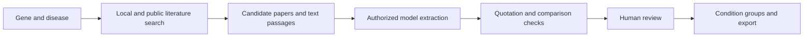

# Gene–Disease Evidence Workbench

**English** | [简体中文](README.zh-CN.md)

A research application for finding and reviewing gene expression evidence in disease. Enter **one gene and one disease**, retrieve relevant literature, and use your own language model service to extract reported expression changes **relative to a normal control**.

**Version: 0.12.0** · Python 3.12 · Streamlit · SQLite · External model API

[Quick start](#quick-start) · [Use your own model](#use-your-own-model) · [中文使用说明](README.zh-CN.md) · [Architecture](docs/ARCHITECTURE.md) · [Validation](docs/VALIDATION.md)


*The interface currently uses Chinese. This screenshot uses synthetic workflow-test documents, not research findings. The development literature database is not distributed with the code.*

## What the application does

The primary question is: **“What evidence reports this gene as increased or decreased in this disease compared with a normal control, and under which conditions?”**

For each candidate, the application retains the source quotation, location, species, tissue or cell type, measurement type, disease group, normal control, and review status. Transcript and protein measurements remain distinct. Treatment comparisons, genetic variants, and activity changes do not automatically establish disease-versus-normal expression differences.

| Capability | Implementation |
|---|---|
| Literature retrieval | Search an optional local PDF text index, PubMed, and optional Europe PMC results; preserve source identifiers and text versions. |
| Model extraction | Send selected text passages to your configured model API and request structured evidence. Abstracts and available readable full text have different source scopes. |
| Batch coverage | Scan up to 300 current candidate records with per-paper passage limits, request budgets, checkpoints, pause and resume. Batch mode needs no paper selection. A five-paper picker appears only in manual mode; optional single-paper preview does not change batch scope. |
| Original workflow adapter | Preserve the original candidate-only BM25 + PubMed → cached vectors → fusion → reranker chain; inspect the final 5, 10, 12 or 15 passages before separately authorizing LLM extraction. |
| Evidence review | Check quotations against retained text, inspect comparison groups, accept, correct or reject results, and retain review history. |
| Results and export | Organize reviewed records by reported conditions and export JSON or Excel files. Conflicting directions and missing conditions remain visible. |
| Demonstration | Run three synthetic teaching scenarios without a model key or model requests. |

The application uses **RAG: retrieval-augmented generation**—retrieve text first, then ask a model to extract from that text. The original workflow uses its BM25 index, PubMed abstracts, cached candidate embeddings, rank fusion and a cross-encoder reranker; the CLI and web adapter share a hash-verified core. It searches vectors within the BM25 candidate pool, not independently over the full corpus. The separate keyword/batch workflow continues to use SQLite FTS5. External models are used through an API; this project does not train a new base model.

The original workflow is optional and requires your original BM25 JSON index, local embedding/reranker weights, and a Python environment with sentence-transformers. Configure it using the [original workflow setup](docs/MODEL_SETUP.md#复用原项目检索流程). A source download does not include these private assets.

An [offline ablation tool](docs/PORTFOLIO_REPORT.md#固定材料的三方法对比工具) compares keyword scoring, candidate-level fusion, and fusion with reranking on identical frozen inputs. It records rankings and timings and exports a blinded Chinese review workbook. Relevance metrics require current-task human judgments; passing software checks is not evidence of retrieval quality or full-corpus recall.

## Workflow



The result is a set of traceable evidence candidates. Grouping identical recorded fields does not establish study comparability or a single biological conclusion.

## Quick start

Development and tests use **Python 3.12 on Linux**. The commands below use a Bash shell; Windows setup has not been verified. Docker is optional and is not required for local use.

```bash
git clone https://github.com/yuweiqiao6-collab/gene-disease-evidence-app.git
cd gene-disease-evidence-app
python3 -m venv .venv
source .venv/bin/activate
python -m pip install -r requirements-lock.txt
RAG_ENABLE_LIVE=false RAG_ENABLE_LITERATURE=false bash scripts/run_local.sh
```

Alternatively, download the repository ZIP, extract it, enter its directory, and follow the environment and startup commands above.

Open **http://127.0.0.1:8501** on the computer running the application. Select one of the three teaching scenarios to inspect evidence, practice reviewing a record, and download results. The scenarios contain synthetic text and preset annotations; accepting a teaching record does not turn it into research evidence.

**Existing environment:** run `bash scripts/run_local.sh` from the project directory. The script prefers an activated virtual environment, then `.venv-release`, then `.venv`. On Linux it can reuse a healthy service or resume a paused service after confirming the same account, project directory and listening process. An unrecognized port owner is left untouched. To choose another port explicitly, use `bash scripts/run_local.sh --port 8502`.

**Remote server or cluster:** first use your existing terminal link and port forwarding provided by your remote development tool. If no forwarding is configured, a manual connection from your own computer is:

```bash
ssh -L 8501:127.0.0.1:8501 USER@SERVER
```

Replace `USER@SERVER` with the account and node actually running the application, keeping any required jump-host settings. The application listens on the server's loopback address; uploading code to GitHub does not start a public website. See the [startup guide](docs/SHOWCASE.md).

## Use your own model

| Mode | Model key | What is sent externally |
|---|---|---|
| Synthetic demonstration | Not required | No model or literature requests with the offline command above. |
| Local literature retrieval | Not required | Local search stays on the server. You must supply your own index. |
| PubMed / Europe PMC retrieval | Not required | Search terms and identifiers go to the selected literature services. |
| Real extraction | Required | Selected text passages and extraction instructions go to your configured model provider after authorization. Charges depend on that provider. |

To enable real extraction:

1. Stop the offline demonstration with `Ctrl+C` in the terminal running it. If `.env` does not exist, copy `.env.example` to `.env`; preserve any existing configuration.
2. Edit the private `.env` using your own provider details:

| Variable | Value to supply |
|---|---|
| `RAG_ENABLE_LITERATURE` | `true` to enable online literature requests. Local search is independent. |
| `RAG_ENABLE_LIVE` | `true` to enable real model extraction. |
| `LLM_API_KEY` | Your model provider's secret key. |
| `LLM_BASE_URL` | The provider's API base URL; the client appends `/chat/completions`. |
| `LLM_MODEL` | A model identifier supported by that provider and your account. |
| `RAG_ACCESS_PASSWORD` | Your own application access password, at least 12 characters long. This is separate from the API key. |
| `RAG_CORPUS_DB` | Optional absolute path to your own local literature index. |

3. Restart without the offline overrides:

```bash
bash scripts/run_local.sh
```

4. Open the real-literature tab, enter the application access password in the sidebar, search for a gene and disease, inspect candidates, choose text scope and request budget, and authorize extraction.
5. Review quotations, comparison groups and experimental conditions before using or exporting the results.

The model endpoint must support the chat-completions request and response format used by this client; provider-specific interfaces may need an adapter. See [model configuration](docs/MODEL_SETUP.md). A “configured” indicator does not verify that a provider is reachable or compatible.

**People who deploy their own copy can use their own API key.** A shared running instance uses the key configured on its server; visitors cannot currently enter individual provider keys in the page. Model keys must stay in the private configuration.

Changing code, `.env`, or startup flags requires restarting the existing service. Reusing an already running service preserves its current configuration. `Ctrl+Z` pauses a foreground program and leaves its port occupied; `Ctrl+C` stops it.

## Add your own literature

The public repository contains teaching examples, not the development paper collection or its index. PubMed records can be searched without importing a local corpus.

To use your own PDFs, prepare page text, build a separate index, set `RAG_CORPUS_DB`, and restart. The [local library guide](docs/FULL_LIBRARY.md) provides the exact commands and input format. The index uses readable PDF text; scanning, figures and complex tables require additional handling.

The system does not search the entire web or Google. Literature availability depends on the configured sources and access conditions. A record may provide only a title and abstract; available full text is optional, and extraction processes a bounded set of passages rather than guaranteeing an exhaustive reading of every paper.

## Project structure

```text
src/                    Application, retrieval, extraction, review and persistence
scripts/                Startup, library preparation, checks and release packaging
tests/                  Automated tests and simulated model/literature responses
examples/               Synthetic examples and sanitized historical check records
docs/                   12 current guides and 5 demonstration screenshots
.streamlit/             Interface and server configuration
.github/workflows/      GitHub automated checks
.env.example            Configuration template with empty credentials
README.zh-CN.md         Complete Chinese introduction
```

Streamlit provides the interface, SQLite stores indexes and private history, PyMuPDF reads PDF text, and Python clients connect to literature and model services. Technical guides currently use Chinese; both README files cover installation, operation and limitations.

## Verification and limitations

Run from the project directory with the configured environment:

```bash
python -m pytest
python scripts/portfolio_check.py --output .runtime/my-portfolio-check.json
python scripts/package_release.py --check
python scripts/sync_original_core.py --check
```

The tests and offline portfolio check do not require real model requests. Tests use controlled fixtures and temporary local services. The [current validation report](docs/VALIDATION.md) records release checks; the [small evaluation report](docs/PORTFOLIO_REPORT.md) separates synthetic workflows, bounded local retrieval timings and three historical abstract-model calls.

Current limits:

- No established independent accuracy or full-corpus recall measurement for the current disease-versus-normal task. Passing software tests is not evidence of medical accuracy.
- Keyword retrieval and limited passage selection can miss relevant evidence. An empty result does not establish that a gene and disease are unrelated.
- A quotation found in source text does not prove that the model interpreted it correctly. Original findings, background statements and review summaries need human checking.
- Different species, tissues, measurements or comparison groups must retain their context. The application does not vote across papers to produce a universal direction or a causal conclusion.
- The interface and persistence are intended for small research workflows. Public production hosting, multiple application replicas, and institutional accounts have not been validated. Container build/run has not been validated.

## Documentation and publishing

[Three-minute walkthrough](docs/SHOWCASE.md) · [User guide](docs/USER_GUIDE.md) · [Task scope](docs/BASELINE_GUIDE.md) · [Batch scanning](docs/BATCH_SCAN_GUIDE.md) · [Architecture](docs/ARCHITECTURE.md) · [Deployment](docs/DEPLOYMENT.md) · [GitHub upload](docs/GITHUB_UPLOAD.md) · [Validation report](docs/VALIDATION.md)

Version 0.12.0 repairs original cache validity and PubMed fusion, adds content-addressed vector reuse, and connects the original retrieval core to the web interface. Medical retrieval accuracy has not been established. The public documentation contains 12 guides and 5 screenshots; development history stays outside the release.

Release packaging excludes private keys, original papers, databases, annotations, recovery codes, runtime outputs and virtual environments. Review the [publication guide](docs/GITHUB_UPLOAD.md) before uploading; GitHub hosts the source, while the Python application needs a separate runtime.

**License:** no formal open-source license has been granted. See [LICENSE_POLICY.md](LICENSE_POLICY.md). Third-party dependencies, models and literature retain their own terms. The project builds on the owner's existing extraction code and uses AI-assisted development; contribution claims should reflect the work actually performed.
