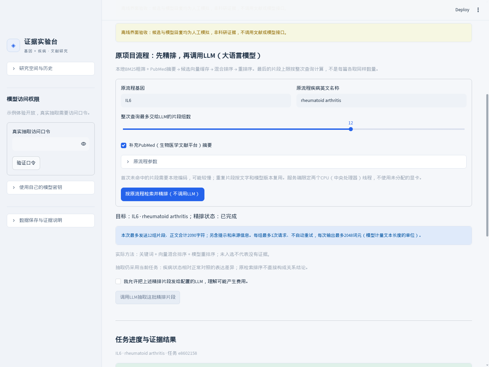

# 基因—疾病证据工作台

[English（英文）](README.md) | **简体中文**

一个用于查找、抽取和人工核对基因表达证据的科研应用。输入**一个基因和一种疾病**，检索相关文献，使用自己的模型接口整理**疾病状态相对正常对照**的表达变化，并保留支持原句和研究条件。

**当前版本：0.12.0** · Python（编程语言）3.12 · Streamlit（网页框架）· SQLite（数据库）· 外部模型接口

[快速开始](#快速开始) · [配置自己的模型](#配置自己的模型) · [架构说明](docs/ARCHITECTURE.md) · [验收记录](docs/VALIDATION.md)



*目前网页界面使用中文。截图使用人工编写的流程测试文献，不是科研证据；开发环境的真实文献库不随代码发布。*

## 项目解决什么问题

主要回答：**“有哪些文献报告，这个基因在该疾病中相对正常对照上调或下调？这些观察分别来自什么条件？”**

每条候选保留文献原句、来源位置、物种、组织或细胞、测量类型、疾病组、正常对照和人工复核状态。转录本水平与蛋白水平分别记录；治疗前后比较、遗传变异或功能活性变化，不会自动认定为疾病相对正常对照的表达差异。

| 能力 | 实际实现 |
|---|---|
| 文献检索 | 检索可选的本地PDF（便携文档格式）文本库、PubMed（生物医学文献平台）和可选Europe PMC（欧洲生物医学文献平台），保留来源编号和文本版本。 |
| 模型抽取 | 通过自己配置的API（程序接口）发送选定片段，要求模型返回结构化证据；区分摘要与可读全文范围。 |
| 批量覆盖 | 扫描本次最多300条候选文献，设置逐篇片段数、请求预算，并支持检查点、暂停和继续。批量模式无需勾选；五篇选择框只在手动模式出现。可选的单篇预览不改变批量扫描范围。 |
| 原流程适配 | 本地BM25＋PubMed摘要合并 → 候选向量缓存 → 混合排序 → 重排序。先查看整次查询前5／10／12／15组，再单独授权LLM抽取。 |
| 证据复核 | 核对引用是否存在于保留文本，检查比较双方，接受、修正或拒绝结果，并保存复核历史。 |
| 阅读与导出 | 按已记录的研究条件整理人工核对结果，导出JSON（结构化文本）或Excel（电子表格）。保留相反方向和缺失条件。 |
| 无密钥演示 | 提供三个完整的人工教学场景，不需要模型密钥或模型请求。 |

RAG（检索增强生成）表示先找资料，再让模型依据资料整理结果。原流程入口使用原BM25索引、PubMed摘要、候选片段向量缓存、排名融合和重排序，终端与网页使用经过内容校验的同版核心。向量搜索仅在粗筛候选内进行，并非全库独立向量召回。独立的关键词与逐篇扫描入口继续使用SQLite FTS5（数据库全文关键词索引）。项目通过接口使用外部现成模型，没有训练新的基础模型。

可用[固定材料的三方法对比工具](docs/PORTFOLIO_REPORT.md#固定材料的三方法对比工具)检查关键词、融合和重排序的差异。工具记录时间与排名，生成中文人工核对表；相关性与有限候选池召回指标需要当前任务的人工答案，不用程序通过率代替检索效果。

原流程入口需自行提供原BM25索引、两个本地模型及已有模型环境，详见[原流程配置](docs/MODEL_SETUP.md#复用原项目检索流程)。代码包不包含这些私有资源；未配置时仍可使用关键词和PubMed入口。

## 工作流程


结果是可追溯的候选证据。记录字段相同，不代表实验之间已经可比，也不代表形成了统一的生物学结论。

## 快速开始

开发与测试环境为**Linux（本项目集群使用的操作系统）和Python 3.12**。下面使用Bash（命令行解释器）；Windows（微软操作系统）的安装流程尚未验证。本地使用不要求安装Docker（容器工具）。

新下载者执行：

```bash
git clone https://github.com/yuweiqiao6-collab/gene-disease-evidence-app.git
cd gene-disease-evidence-app
python3 -m venv .venv
source .venv/bin/activate
python -m pip install -r requirements-lock.txt
RAG_ENABLE_LIVE=false RAG_ENABLE_LITERATURE=false bash scripts/run_local.sh
```

其中`git clone`表示下载代码，`venv`创建项目独立环境，`pip install`安装依赖。也可以在GitHub下载ZIP（压缩包），解压后进入项目目录，从创建环境开始执行。

在**运行应用的同一台电脑**打开 **http://127.0.0.1:8501**。进入三个教学场景之一，查看原句、练习复核并下载结果。这些场景使用人工材料和预设答案；保存“接受”后仍是教学数据。

**已有集群环境：** 在项目目录执行 `bash scripts/run_local.sh` 即可。脚本优先使用已激活的虚拟环境，再查找`.venv-release`、`.venv`。在Linux上，它会核实账号、项目目录和端口所属进程，复用正常服务或恢复被暂停的同一服务；无法确认占用者时只提示。需要明确换端口时执行 `bash scripts/run_local.sh --port 8502`。

**从电脑访问远程集群：** 先沿用原来点击终端网址的方式。如果远程开发工具已有端口转发，就不用另开电脑终端。没有转发通道时，可在个人电脑执行SSH（加密远程连接）转发：

```bash
ssh -L 8501:127.0.0.1:8501 USER@SERVER
```

替换为实际账号和运行应用的节点地址，并保留自己需要的跳板机设置。程序默认只监听服务器本机地址；上传到GitHub不会自动生成公众可访问的网站。详细操作见[启动和演示指南](docs/SHOWCASE.md)。

## 配置自己的模型

| 模式 | 是否需要模型密钥 | 向外发送什么 |
|---|---|---|
| 人工示例 | 不需要 | 使用上面的离线命令时，不请求模型或在线文献。 |
| 本地文献检索 | 不需要 | 在服务器本地检索；需提供自己的索引。 |
| PubMed或Europe PMC检索 | 不需要 | 向选定文献服务发送查询词和文献编号。 |
| 真实模型抽取 | 需要 | 确认授权后，向配置的模型服务发送所选片段和抽取指令；费用按服务商规则计算。 |

启用真实抽取：

1. 在运行离线演示的终端按`Ctrl+C`停止程序。没有`.env`时，将`.env.example`（空密钥模板）复制为私有`.env`；已有配置不要覆盖。
2. 在私有配置中填写自己的服务信息：

| 配置名 | 含义与填写方式 |
|---|---|
| `RAG_ENABLE_LITERATURE` | 设为`true`开启在线文献请求；本地检索不依赖此开关。 |
| `RAG_ENABLE_LIVE` | 设为`true`开启真实模型抽取。 |
| `LLM_API_KEY` | 自己的模型接口密钥。 |
| `LLM_BASE_URL` | 服务商提供的接口基础地址；程序会追加`/chat/completions`（聊天补全接口路径）。 |
| `LLM_MODEL` | 服务商和自己账号实际支持的模型标识。 |
| `RAG_ACCESS_PASSWORD` | 自行设置至少12字符的网页访问口令，与模型密钥不同。 |
| `RAG_CORPUS_DB` | 可选，自己的本地文献索引的绝对路径。 |

3. 不带离线开关重新启动：

```bash
bash scripts/run_local.sh
```

4. 在“真实文献与模型抽取”页签，先在侧栏填写网页访问口令，再检索基因和疾病，检查候选、选择文本范围与请求预算，并确认允许外发后开始抽取。
5. 核对引用、比较双方和实验条件，再决定接受、修正、拒绝或导出。

模型服务需要兼容本项目使用的聊天补全请求和返回格式；独有接口可能需要编写适配代码。详见[模型配置说明](docs/MODEL_SETUP.md)。页面显示“已配置”，只说明字段已填写，不表示服务连接和兼容性已验证。

**下载代码自行部署的人，可以使用自己的API key（模型接口密钥）。** 多人使用同一个网页时，目前共用部署端配置的密钥，不支持访客在网页上临时输入各自的模型密钥。密钥应保留在私有配置中。

修改代码、`.env`或启动开关后，需要停止旧服务再启动。复用已有进程不会应用新配置。`Ctrl+Z`会暂停前台程序并继续占用端口；`Ctrl+C`才会停止它。

## 接入自己的文献

公开仓库包含教学示例，不包含开发者的论文原文或索引。没有本地文献库，也可以检索PubMed记录。

已有PDF时，先准备逐页文本，再单独建库，设置`RAG_CORPUS_DB`并重启；具体命令和输入格式见[本地全文库指南](docs/FULL_LIBRARY.md)。索引使用可读PDF文字，扫描图片、图表和复杂表格需要额外处理。

目前不检索整个互联网或Google（谷歌搜索）。可用文献由数据来源和访问条件决定；有些记录只有标题和摘要。全文按可获得情况选用，模型处理有上限的片段，不能保证穷尽每篇论文全部内容。

## 项目结构与技术

```text
src/                    网页、检索、抽取、复核与数据保存
scripts/                启动、文献准备、检查和打包脚本
tests/                  自动测试及模拟的模型和文献响应
examples/               人工教学数据与去除私有信息的历史记录
docs/                   指南、架构、截图和验收报告
.streamlit/             网页主题与服务配置
.github/workflows/      GitHub自动化检查
.env.example            不含密钥的配置模板
README.md               完整英文介绍
```

Streamlit负责界面，SQLite保存索引和私有历史，PyMuPDF（PDF文字解析库）负责读取PDF文字，Python客户端连接文献及模型服务。技术指南目前主要使用中文；两份README均包含启动、配置、使用方式和局限。

## 如何验证及目前的局限

在配置好的环境、项目目录中执行：

```bash
python -m pytest
python scripts/portfolio_check.py --output .runtime/my-portfolio-check.json
python scripts/package_release.py --check
```

`pytest`运行自动测试；`portfolio_check.py`验证离线展示流程；`package_release.py --check`检查公开包的文件范围和敏感信息规则。这些检查不需要真实模型请求，测试使用固定材料和临时本机服务。

[本版验收记录](docs/VALIDATION.md)说明发布检查范围。[小型效果报告](docs/PORTFOLIO_REPORT.md)分别列出人工流程、本地有界检索计时和此前三篇摘要的真实模型调用，不能混作同一种质量指标。

目前的局限：

- 当前疾病与正常对照任务，尚无独立完整的准确率和全库召回率评测。程序测试通过不等于医学判断准确。
- 关键词检索与有限片段可能漏掉相关证据；空结果不代表基因与疾病无关。
- 原句确实存在，不保证模型解释正确；需要人工区分原研究、背景陈述和综述转述。
- 不同物种、组织、测量和比较组必须保留条件；不按论文多数票给出统一方向或因果结论。
- 目前面向小规模科研辅助；正式公网、多副本和机构账号体系尚未验证，容器构建运行也尚未验证。

## 文档、发布与许可

[三分钟演示](docs/SHOWCASE.md) · [使用说明](docs/USER_GUIDE.md) · [任务范围](docs/BASELINE_GUIDE.md) · [批量扫描](docs/BATCH_SCAN_GUIDE.md) · [架构说明](docs/ARCHITECTURE.md) · [部署说明](docs/DEPLOYMENT.md) · [上传GitHub](docs/GITHUB_UPLOAD.md) · [验收记录](docs/VALIDATION.md)

0.12.0修复原缓存有效性和PubMed融合，增加跨查询片段向量复用，并接回原检索核心。检索医学准确率仍未建立。公开文档只保留12份指南和5张截图，开发历史不随发布包上传。

发布脚本排除密钥、真实论文、数据库、人工标注、恢复码、运行结果和虚拟环境。上传前按[发布指南](docs/GITHUB_UPLOAD.md)核对。GitHub（代码托管平台）保存源码；Python应用实际运行需要单独的环境。

**许可：目前尚未授予正式开源许可证。** 详见[许可说明](LICENSE_POLICY.md)。第三方依赖、模型和文献分别受原有条款约束。本项目基于项目所有者已有抽取代码改造，并使用人工智能辅助开发；展示贡献时应按实际完成的工作描述。
