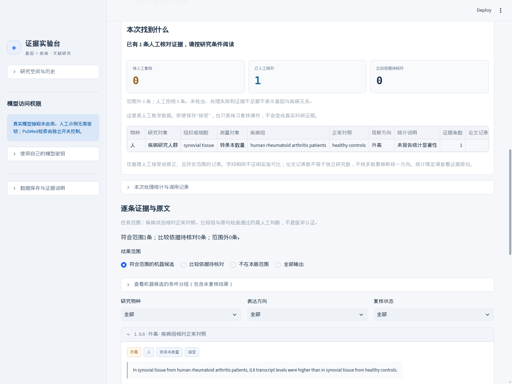

# 三分钟演示与实际查询

版本0.12.0。默认进入“人工示例体验”，三个场景均为人工编写材料和预设标注，不调用模型，不是真实医学结论。

## 已有集群环境

在自己的终端进入项目目录，复用已有环境。下面的目录是占位符，请替换为实际项目目录：

```bash
cd /path/to/gene_disease_evidence_app
bash scripts/run_local.sh
```

脚本优先使用当前已激活的环境，否则依次查找本项目的`.venv-release`、`.venv`，不安装依赖。
已有正常服务时显示访问地址，不重复启动；若确认本账号、本目录的同一服务被暂停，则恢复它并检查响应。
无法确认占用者时仅提示退出，不停止或恢复其他服务。可指定其他端口：`bash scripts/run_local.sh --port 8502`。
这些自动识别和恢复能力用于Linux（集群操作系统）；其他系统无法确认已有服务时会提示人工处理。

新版代码或配置需要重启自己原有的网页进程才能加载；复用服务不会自动重新加载。
如果当前终端正在运行自己的旧网页，可先用Ctrl+C（中断当前进程）结束，再启动；不要关闭其他人的进程。
Ctrl+Z表示暂停，仍会占用端口；若已回到命令提示符，可重新执行启动脚本恢复，或在原终端用`fg`（恢复到前台）后按Ctrl+C停止。
新下载者按[中文首页](../README.zh-CN.md)创建独立环境和安装依赖，不要求安装Docker（容器工具）。

同一台电脑访问 `http://127.0.0.1:8501`。远程集群先沿用原来的访问方式，点击终端网址。
如果远程开发工具已转发端口，就不需要另外开启个人电脑终端；重连后可能需要恢复工具中的端口转发。
如果没有自动转发通道，再在个人电脑进行SSH（加密远程连接）转发：

```bash
ssh -L 8501:127.0.0.1:8501 USER@SERVER
```

替换实际账号和运行节点地址，沿用自己的跳板机设置。应用若在计算节点，不能默认登录节点就是运行节点。

## 三类完整场景

1. **查看明确比较**：向下看“任务进度与证据结果”，出现一条候选。展开证据，检查疾病组、正常对照、测量对象与原句。展开“核对或修正这条证据”，选择接受，填写“教学演示”并保存；上方概况随之显示人工核对记录。它仍是教学数据。
2. **查看条件差异**：出现两条不同条件的候选。展开“查看机器候选的条件分组”，观察患者组织转录水平与培养细胞蛋白结果分别保存。此分组包含未复核机器候选，不等于综合判断。
3. **查看证据不足**：已有一个候选片段，但没有适用表达结果；页面说明当前材料不足，不写成基因与疾病无关。

默认每分钟最多三个任务。更多原有基因教学案例保留在折叠区；连续重演可稍等。



选择“仅导出人工接受或修正的证据”再下载时，只包含已保存为接受或修正的记录。页面物种和方向筛选不改变下载范围。
恢复码可找回研究空间；它是访问凭据，截图与录屏时不要展开。

## 真实结果与模型配置

同一页展开“查看已有真实调用复盘”，可以阅读此前三篇公开摘要的运行记录及剩余问题，不会重新发请求。任务范围与本版不同，不能当作新版准确率。详细数据见[效果与失败分析](PORTFOLIO_REPORT.md)。

实际使用切换“真实文献与模型抽取”：

1. 输入基因和疾病英文名称，选择本地、联合或在线检索。
2. 查看本次候选，默认自动扫描全部当前候选，无需勾选。可展开单篇预览；只有切换到手动模式才需选择最多五篇。
3. 确认目标、片段范围、篇数和请求预算，启用并通过模型访问权限后提交。
4. 查看逐篇覆盖、原句和人工复核结果，再导出。

只开启在线检索、不启用模型的启动方式：

```bash
RAG_ENABLE_LIVE=false RAG_ENABLE_LITERATURE=true bash scripts/run_local.sh
```

真实模型配置见[使用自己的模型](MODEL_SETUP.md)。模型密钥在服务端私有配置中设置，不填入访问口令框；网页当前不支持访客临时输入个人密钥。
本轮没有新增真实模型请求，也没有正式公网发布。

面试演示可按三分钟安排：先用30秒说明“查询一对基因和疾病、保留表达方向与条件”的目标；用90秒完成示例、复核和下载；再用30秒说明[检索、模型接口与保存流程](ARCHITECTURE.md)；最后30秒说明[已有验证及其限制](PORTFOLIO_REPORT.md)。模型来自外部服务，项目没有训练基础模型；介绍个人贡献时，应区分自己完成的工作、原有代码和AI（人工智能）辅助开发。


## 演示原检索流程

配置后在真实文献页选择“混合检索与精排”，先检索并精排，查看本地与PubMed来源、缓存复用数量及最后5／10／12／15组。此时不调用LLM。对外演示使用人工候选的截图需要明确标为人工流程测试；真实模型排序不等于真实LLM已正确抽取关系。
只有通过访问口令并确认外发后才提交这批固定片段，不扩大为每篇各取同样数量。更全面覆盖与最低调用量是不同目标，逐篇扫描入口继续保留。
